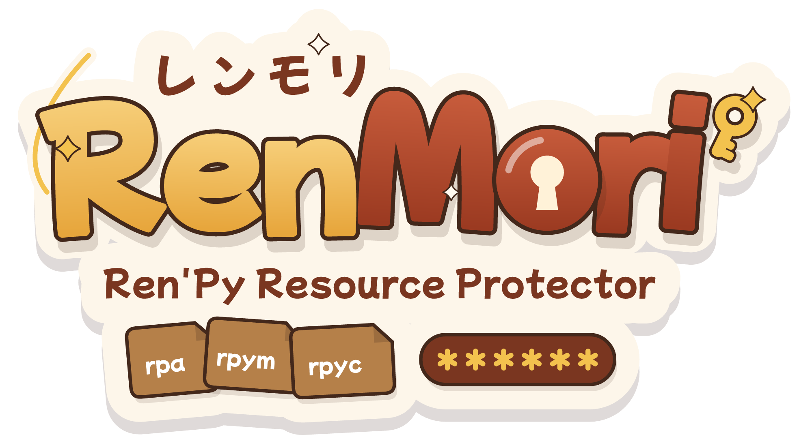

<div align="center">



   [](README.zh-CN.md) [](README.ja.md)  

**Full-data protection for commercial Ren'Py visual novels — 100% free**

RenMori takes a Ren'Py 8.x build and produces a protected distribution: every asset — scripts, sprites, CGs, audio, video, fonts, translations, and configuration — is packed into an encrypted container and decrypted only inside the running engine. A game that runs on the player's machine can never be made uncrackable, so RenMori maximizes the cost of extraction — off-the-shelf unpackers and most lazy agents fail outright — but it cannot stop an expert-level reverse. The honest threat model is [here](https://renmori.mewbaka.cn/en/technical/threat-model).

</div>

---

## 1. Install & use the CLI

### Install

```bash
pip install renmori
renmori --version
```

Requires **Python 3.9+** on the developer's machine (reading a `renmori.toml`
config needs 3.11+, or `pip install tomli` on older versions). `cryptography` is
pulled in automatically. To work on the source instead:

```bash
git clone https://github.com/MewBaka/RenMori.git
cd RenMori && pip install -e .
```

### Protect a game

1. **Build your game** in the Ren'Py launcher (*Build Distributions*). RenMori
   runs on that output and never touches your source.
2. **Protect the build** — the input is the built folder, or the `.zip` the
   launcher made (it is unzipped for you):

   ```bash
   renmori protect ./dist/MyGame-1.0-pc -o ./dist/MyGame-1.0-pc-protected
   # or straight from the archive:
   renmori protect ./dist/MyGame-1.0-pc.zip
   ```

   The first full protect downloads the closed plugin for your platform from the
   public release, verifies it, and caches it — no manual step. On a terminal it
   asks first; in CI it downloads automatically.

3. **Verify** the result (usable as a CI gate):

   ```bash
   renmori verify ./dist/MyGame-1.0-pc-protected
   ```

4. **Ship** the protected folder as your release (`renmori.rmc` + `renmori.rpe`
   together). Don't re-run the Ren'Py launcher on it — that rebuilds from source
   and drops the protection.

The command is zero-config by default, prints a machine-readable JSON result line
for CI, and has clear exit codes. An optional `renmori.toml` controls chunk size,
an exclude list, lockdown, strength, and key sources. For the open-source
**baseline** format (no plugin, fully offline), pass `--strength baseline`. Full
reference: [the CLI docs](https://renmori.mewbaka.cn/en/cli/overview) and
[the renmori.toml example](https://renmori.mewbaka.cn/en/cli/configuration).

---

## 2. Documentation

The full documentation lives at **[renmori.mewbaka.cn](https://renmori.mewbaka.cn/en/)** — the key pages, in the order you'll need them:

**Understand it**

- [Introduction](https://renmori.mewbaka.cn/en/guide/introduction) — what RenMori is and what it protects
- [Research](https://renmori.mewbaka.cn/en/technical/research) — what already exists and why a new tool is needed
- [Architecture](https://renmori.mewbaka.cn/en/technical/architecture) — the full design, layer by layer
- [Threat model](https://renmori.mewbaka.cn/en/technical/threat-model) — what it stops, and what it cannot

**Protect your game**

- [Quick start](https://renmori.mewbaka.cn/en/guide/quick-start) — from a build to a protected release
- [CLI reference](https://renmori.mewbaka.cn/en/cli/overview) — `protect` / `verify`, flags, and output
- [Configuration](https://renmori.mewbaka.cn/en/cli/configuration) — the `renmori.toml` file
- [The plugin](https://renmori.mewbaka.cn/en/cli/plugin) — baseline vs. full protection and the closed binary

**Automate in CI**

- [CI & key management](https://renmori.mewbaka.cn/en/integration/ci) — pipelines, secrets, and a sample GitHub Actions workflow

**Ship**

- [Steam release](https://renmori.mewbaka.cn/en/integration/steam-release) — overlay, DRM, and Steamworks

**Internals & reference**

- [Container format](https://renmori.mewbaka.cn/en/technical/container-format) · [Loader hook](https://renmori.mewbaka.cn/en/technical/loader-hook) · [Script layer](https://renmori.mewbaka.cn/en/technical/script-layer) · [Plugin interface](https://renmori.mewbaka.cn/en/technical/plugin-interface)

---

## 3. Licensing

RenMori — the framework and tools, the closed plugin, and the runtime that ships
inside a game — is under the **RenMori License 1.0**:
[`LICENSE`](LICENSE) (Chinese: [`LICENSE.zh-CN.md`](LICENSE.zh-CN.md)).

- **Free to use.** Protecting any Ren'Py game, commercial or not, is free, and the
  RenMori runtime may be redistributed embedded in a released game at no charge.
- **No resale.** Selling RenMori itself or a modified version, or running a paid
  "encryption-as-a-service" with it, is not permitted.
- This is a **source-available** license, not an OSI open-source one, because the
  no-resale term cannot be expressed under a permissive license.

Third-party notices are in [`NOTICE`](NOTICE) (note the FFmpeg LGPL/GPL terms). No
warranty of unbreakability is given — see the license and the
[threat model](https://renmori.mewbaka.cn/en/technical/threat-model).

Full terms and developer guidance are on the docs site: [disclaimer](https://renmori.mewbaka.cn/en/license/disclaimer), [contribution terms](https://renmori.mewbaka.cn/en/license/contributing), and [notes for developers](https://renmori.mewbaka.cn/en/license/developer-notes).

For licensing questions or technical help, contact: *team@mewbaka.cn*
